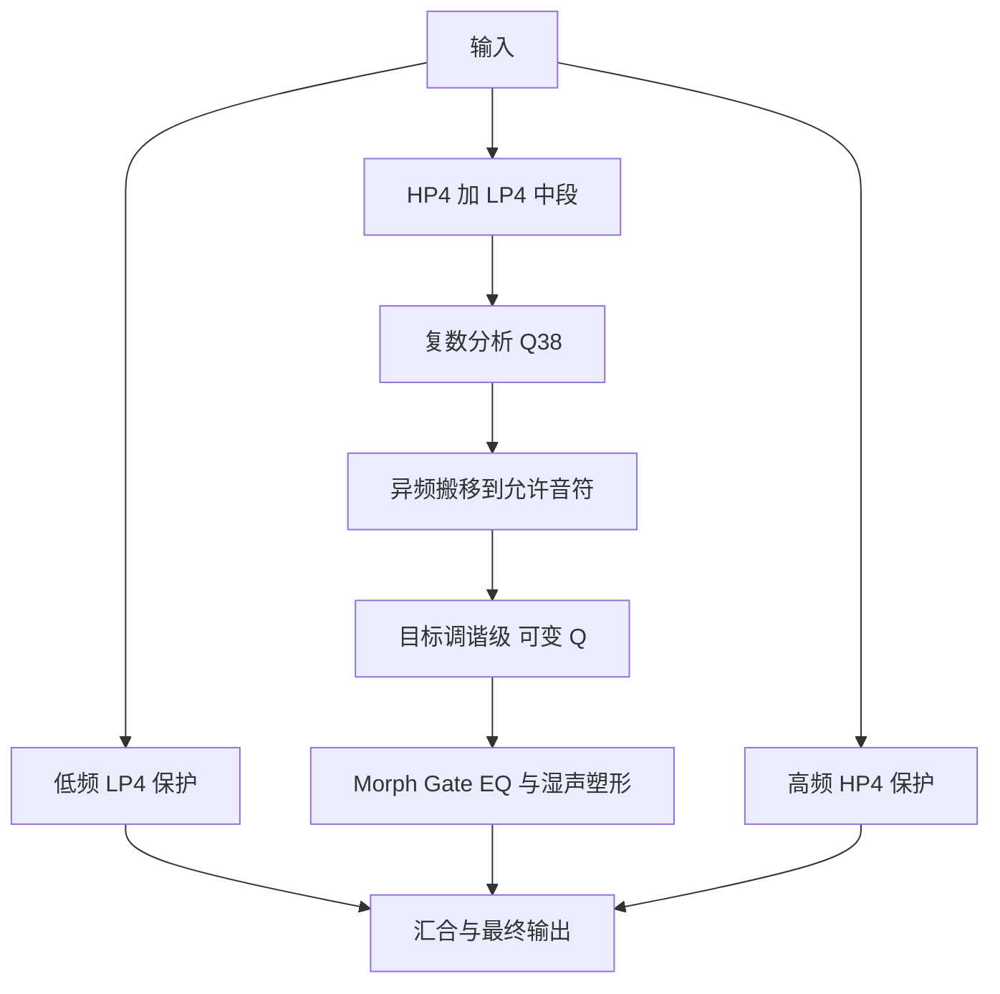

# Iris Color 0.5.0 · Prism 中文指南

**Windows x64 VST3 · 用于 Color bass 的音阶染色效果器**

0.5 的重点是重做主染色核心：让音阶上的共振集中、音级之间的底谱下降，并让起音、俯冲和音级运动直接改变主染色层。界面保留 Main、Bands + EQ、Motion 三页，以及水蓝、鼠尾草绿、灰紫和暖米白的配色。

*原生界面示意，来自 Glass / E minor pentatonic 等宿主交互测试设置；实际试听参数见第 2 节参考表。*

## 1. 安装、升级与旧工程

1. 关闭 FL Studio。解压 Windows 版本，把 **`Iris Color.vst3` 整个文件夹**复制到 `C:\Program Files\Common Files\VST3\`。最终路径应为 `C:\Program Files\Common Files\VST3\Iris Color.vst3`。
2. 升级时整体替换原来的同名文件夹，保留 bundle 内的 `Contents`、二进制与资源目录结构。
3. 打开 **Options → File settings → Manage plugins**，勾选 **Verify plugins** 和 **Rescan previously verified plugins**，点击 **Find installed plugins**。
4. 在 Mixer 效果槽加载 Iris Color。路径和扫描方法见 [Image-Line 官方安装说明](https://www.image-line.com/fl-studio-learning/fl-studio-online-manual/html/basics_externalplugins.htm)。

**Core 决定使用哪个算法。**新建实例默认 **Prism 0.5**；载入没有 Core 字段的旧工程或旧状态时，自动选择 **Legacy 0.4**。旧参数 ID 保留，新 Core 使用 ID 75。预设切换保留 Core，界面分别显示核心与预设名。要把旧工程换成新音色，手动切到 Prism 后保存；同一组旋钮在两个核心中的声音会不同。依据：`plugin/IrisParameters.cpp`、`src/IrisPresets.h`。

## 2. 先用这组设置对照 Chroma 音频

这是 Iris 的参考起点。你明确提供的 Chroma 设置只有 Color 150%、230–4000 Hz、High Quality，其余参数未知。下面的音阶由录音频谱推断，不代表已经确认原插件的完整状态。

| 项目 | Iris 参考设置 |
|---|---|
| Core | **Prism 0.5** |
| Root / Scale | **D# / Minor pentatonic**，音集 D#、F#、G#、A#、C# |
| Color / Snap | **150% / 100%** |
| Low / High | **230 Hz / 4000 Hz** |
| Decay | **200 ms** |
| Morph / Gate | **都关闭** |
| Transient / Width | **0% / 100%** |
| 三段 Color | 都为 **100%**；交叉点先留 700 / 3000 Hz |
| Broad EQ / Paint EQ | 全部 **0 dB** |
| 五个创意效果 / MIDI | 都关闭 |
| Output / Soft Limit | **−6 dB / 开启**，用于留出试听余量 |

你的参考文件约 **1.45% 的左右声道采样点顶在 PCM16 的同一上下边界**。它可能来自插件后级或导出环节，无法从 WAV 确认发生位置。先采用上述输出余量，再匹配响度比较；Soft Limit 本身也会改变波形。数学对照使用单独记录的原始浮点输出，与这组安全试听电平分开记录。依据：[reference-measurements.json](../Validation/reference-measurements.json)。

在 FL 中手动设好参数后，使用 Mixer 效果槽菜单 **Save Preset as** 保存为自己的 `.fst`，方法见 [FL 官方效果槽说明](https://www.image-line.com/fl-studio-learning/fl-studio-online-manual/html/mixer_plugin.htm)。外部 `.vstpreset` 文件可供支持该格式的宿主导入；尚未确认 FL 直接导入兼容性。**Reference 是外部参考设置，不在现有 10 个工厂预设下拉中。**

### 对照试听怎么听

解压后打开包根的 [Listen.html](../Listen.html)，页面提供分段跳转。5 个 WAV 都为 44.1 kHz、双声道 PCM24。

| 试听组 | 内容 |
|---|---|
| 01 · 新版完整输出 | Prism Color 150% 单独试听 |
| 02 · 全频对照 | 原音 → 旧 0.4 → Chroma 参考 → Prism 0.5 |
| 03 · 染色中段 | 对三者统一施加 300–3700 Hz 测量带通，顺序 0.4 → Chroma → Prism；用于集中比较中段 |
| 04 · Color 对照 | 100 → 150 → 200%，其余音色参数相同 |
| 05 · 五个创意处理 | 基线 → Attack/Tail → Dive → Scale Motion → Formant → Tamer；每段只开对应功能 |

每段约 6.804 秒，段间静音 0.35 秒。包内比较音频采用未限幅浮点渲染，再对每组所有片段应用相同播放衰减，衰减量至少为 6 dB；**没有逐段响度归一化，电平差仍保留**。这与上表手动试听建议的 Soft Limit 开启状态分开记录。300–3700 Hz 带通只用于第三组试听，插件仍使用 230–4000 Hz 参考范围。时间轴、原始参数和全部增益见 [reference05-audio.json](../Validation/reference05-audio.json)。

## 3. 主参数分别改变什么

| 参数 | 范围 | 在 Prism 中的作用与使用方法 |
|---|---|---|
| Color | 0–200% | 0–100% 从对齐干声过渡到染色湿声；100–200% 提高目标共振级的 Q 与增益，让音阶峰更集中 |
| Snap | 0–100% | 控制向允许音符靠拢的程度和染色中段的参与量。0% 回到未调谐中段，100% 用于明确的音阶集中 |
| Root / Scale | 12 根音、6 种音集模式 | 定义目标音级；Custom 键盘使用绝对音名，MIDI 模式可用收到的音符动态选择音集 |
| Low / High | 60–1500 / 1000–18000 Hz | 白色边界决定主处理区间；低高保护支路保留干声来源，边界有滤波过渡 |
| Decay | 25–1500 ms | 调节超过 Color 100 后的目标共振 Q。Prism 保留旧单位作为衰减参考量；各音高不会拖尾相同毫秒数。Color 150、三段 100、Decay 200 对应目标级 Q38 |
| Transient | 0–100% | 起音时增加对齐原始干声的回归，保留冲击感；较大值也会降低起音瞬间的染色比例 |
| Width | 0–160% | 改变湿中段侧声道量；100% 保持该层宽度，0% 收至中央，超过 100% 加宽；保护支路独立保留 |
| Morph 开关 / Amount | 0–100% | 将湿声频谱幅度逐渐替换为干声幅度，保留湿声相位；详见下一节 |
| Gate 开关 / Threshold | −96–0 dB | 根据对应干声频率格决定该湿声格是否通过；阈值越高，关闭的频率通常越多 |
| Output | −24 至 +12 dB | 整体输出增益；推高 Color、EQ 或 Tail 后可下调以留出余量 |
| Soft Limit | 开 / 关 | 最后一级软限幅，会压缩较大采样峰；不提供 true-peak 限制保证 |
| Bypass | 开 / 关 | 切回保持宿主延迟的原始干声；稳定旁路为单位增益，不受 Output 和 Soft Limit 影响 |

Color 0 的湿声份额为零，但 Output 和 Soft Limit 仍生效。严格逐采样干声对照应设置 Output 0 dB、Soft Limit 关闭。旁路切换有平滑过渡。**Pitch Dive、Scale Motion 位于调谐支路内，Snap 0 时不会起作用；试听这两个效果请先用 Snap 100。**

### Morph 与 Gate 的准确含义

[Chroma 官方手册](https://www.xynth.audio/docs/plugins/chroma)说明：Morph 在线性域混合干湿频谱**幅度**，保留湿声相位；Gate 用干声作为逐频率格的侧链，关闭低于阈值的对应湿声格。Iris 按这些公开行为独立实现。

令一个频率格的湿声为 $W_k$、干声为 $D_k$，Morph 比例为 $m\in[0,1]$。非零湿声时先计算：

$$
Y_k=\big[(1-m)|W_k|+m|D_k|\big]e^{j\arg W_k}.
$$

**Morph 0** 保留湿谱；**Morph 100** 使用干谱幅度和湿谱相位，仍可能与干声不同。原始起音和收尾的频谱包络会更多地约束染色，强 Morph 也可能削弱想保留的拖尾。后续 EQ 仍会改变这些幅度。

**Gate** 对左右声道采用共同开关，以较大的干声频率格幅度判断阈值。低频仍存在时，高处已无干声激励的共振尾音可以被单独切短。Prism 的侧链取自同一 LR4 中段的干声，保护支路随后汇合。它没有节奏步进表。实现见 `src/IrisDSP.cpp`。

## 4. 为什么 Color 100、150、200 会不同

Prism 用复数滤波器组分析各半音附近的信号，通过异频搬移把该频率邻域送向允许音符，再进入调谐共振级。左右声道共用搬移相位，各自保存滤波状态。

LP4、HP4 是四阶 Linkwitz–Riley 滤波支路。两条保护支路直接相加，没有另加全通相位补偿，分界附近会保留这些滤波器的幅相影响。中段还保留一小部分宽带底，平衡音阶集中和原始质感；其强度随稀疏音集和稳定单音检测调整。

三段 Color 都为 100%、Decay 200，尚未计入音集密度补偿时：

| Global Color | 目标级 Q | 原本在允许音符上的支路增益 | 需要搬移的支路增益 |
|---|---:|---:|---:|
| 100% | 12 | 1.25 | 0.65 |
| 150% | 38 | 3.00 | 1.00 |
| 200% | 64 | 4.75 | 1.35 |

这些是单支路系数，不能直接换算成整体响度。局部量为 $u=\operatorname{clamp}(\max(0,(Color-100)/100)B,0,2)$，其中 $B$ 是该目标频率处三段 Color 的加权比例。目标级使用 $Q=\operatorname{clamp}(12+2u(38\,Decay/200-12),4,300)$。每段 Color 同时影响局部峰的锐度和强度。完整补偿规则见 `src/IrisPrism.h`。

参考设置下两个级都为 Q38。高音衰减更快，单级时间常数约为 $Q/(\pi f)$；串联后的总尾音含额外包络项，不能把整个尾音硬拟合为单一指数，也不能把总峰宽当作单级 Q。参考录音的逐音尾音分析支持近似恒 Q；先前仅看总包络得出的固定 Hz 带宽猜测已被逐音证据推翻。依据：[tail-pole-summary.json](../Validation/tail-pole-summary.json)、[05-tail-analysis-calibration.json](../Validation/05-tail-analysis-calibration.json)。

## 5. 手动 Color bands 与染色 EQ

*原生界面示意；图中自定义 EQ 用于展示交互，实际参考试听使用平直 EQ。*

| 控件 | 范围 | 改变的对象 |
|---|---|---|
| Low / Mid / High Color | 各 0–200%，中性 100% | Global Color 超过 100 后的局部 Q 和增益；某段 0% 仍保留基础染色 |
| L/M 分频点 | 120–2000 Hz，默认 700 Hz | Low 与 Mid 交叉中心 |
| M/H 分频点 | 1000–12000 Hz，默认 3000 Hz | Mid 与 High 交叉中心，至少为 L/M 的 1.25 倍 |
| 三段 Broad EQ | 各 −12 至 +12 dB | 整个湿中段的宽范围平衡 |
| 16 段 Paint EQ | 各 −24 至 +12 dB | 固定节点覆盖 80 Hz–16 kHz，细化整个湿中段频谱 |

在 **Bands + EQ** 拖动 L/M、M/H 的整条彩色分频线；Shift 可细调。点击频率框可输入 `700`、`700 Hz`、`3k`、`3 kHz`。Enter 应用，Escape 或离开输入框取消；无效输入保留供修改。白色 Low / High 处理边界与这两条彩色线分别控制不同功能。

在 Paint EQ 图上拖动或横向绘制，一次可经过多段；选中节点可输入精确 dB，双击复位单段。**Flat EQ 同时归零 16 段 Paint EQ 和 3 段 Broad EQ**。EQ 节点中心频率固定，可移动的是 Color 分频点。

三个 Color 值相同、三个 Broad EQ 都为 0 dB 时，移动交叉点不会改变音色。可先设 Low / Mid / High Color 为 **50 / 160 / 70%**、Global Color 为 **150%**，再移动彩色线判断作用范围。两层 EQ 处理湿声，范围外的保护支路不会跟随湿 EQ 全量增减。

## 6. 五个创意效果

*原生界面示意；实际参考试听先关闭这些创意效果，再逐项比较。*

Prism 中 **Attack / Tail、Pitch Dive、Scale Motion 作用于主染色层，Color 100% 时已有效**。Legacy 保留只影响超过 Color 100 后附加共振的旧行为。Formant、Tamer 在两种核心中均处理整个湿声。

| 效果 / 参数 | 范围 | 作用与起点 |
|---|---|---|
| Attack / Tail 开关 | 开 / 关 | 每次检测到干声起音后，重新开始染色强度包络 |
| Attack / Tail | 各 0–200% | 起音、尾部的主染色增益；先试 20 / 150% |
| Transition | 5–500 ms | 从 Attack 接近 Tail 的时间尺度；先试 100 ms |
| Pitch Dive 开关 / Start | −24 至 +24 半音 | 起音后改变主染色目标频率；正值从上方下降，负值从下方上升；先试 +12 |
| Dive time | 10–1000 ms | 回到音阶目标的时间尺度；先试 140 ms |
| Scale Motion 开关 / Depth | 0–100% | 轮流强调允许音级，越大则未选中音级越弱；先试 90% |
| Sync / Beat / Free rate | 1/1–1/32；0.25–20 Hz | Sync 跟随宿主拍点，关闭后用独立速率；先试八分音符。只有一个有效音级时，轮流强调的变化很少 |
| Formant 开关 / Mix | 0–100% | 在湿谱上加入元音形状；先试 60% |
| Vowel | A、E、I、O、U 连续位置 | 选择元音中心形状；不会识别人声或让音频说出文字 |
| Motion / Rate | 0–100%；0.05–8 Hz | 元音位置的摆动幅度和速度；先试 60%、0.5 Hz |
| Peak Tamer 开关 / Amount | 0–100% | 检查局部频谱突峰并衰减，左右共用增益；先试 60% |
| Max cut | 0–18 dB | 限制 Tamer 最大压低量；先试 6 dB。稳定单音有保护规则，不能保证识别所有不好听的频率 |

**Bloom / Dive / Ripple / Vowel / Silk** 分别展示这五种效果；Init、Glass、Clean、Gun、Water 保留。预设名随实际参数匹配，音色偏离完整快照后显示 Custom。Root、Scale、自定义音集、MIDI、Bypass、Output、Soft Limit、Core 作为工程上下文保留。

## 7. 当前证据与实际限制

**以下为正式构建的测量。**它们是同一素材的后半段开发对照：前段 0.05–3.15 秒，后段 3.25–6.4 秒，统计范围 340–3400 Hz。迭代时已查看后半段，Q38 也来自同一参考，因此不能将其称为独立素材盲测。

| 后半段指标 | 旧 0.4，Color 150 | Prism 0.5 | Chroma 参考 |
|---|---:|---:|---:|
| 对数功率谱 RMSE，越低越接近该统计量 | 10.323 dB | **2.688 dB** | 0 dB |
| 音阶峰与音级间谷的中位增益差 | 10.705 dB | **26.794 dB** | **26.231 dB** |

来源：[reference05-audio.json](../Validation/reference05-audio.json)，辅助记录为 [prism05-final-metrics.json](../Validation/prism05-final-metrics.json)。峰谷差增加说明音阶间底谱下降；这些统计不能换算成“复刻百分比”，也不能代表所有音乐。

独立合成素材另检查宽带瞬态、F4→E4 实际搬频、后期尾音、三个 Motion 和干声端点。最终 8 组行为检查均通过，见 [05-test-final.json](../Validation/05-test-final.json)；实际旧版失败保留于 [05-test-red.json](../Validation/05-test-red.json)。组合音记录 [05-motion-offgrid.json](../Validation/05-motion-offgrid.json) 表明 Scale Motion 能保住所选音级的能量，但**多音输入中的 ±40 音分偏移可能保留**。Prism 对稳定孤立单音精细校正，多音和噪声采用半音邻域搬移，尚不能保证任意多音、微分音都精确吸附。

默认延迟在 Prism、Legacy、Color 0 和 Bypass 中都为 **3072 采样**：44.1 kHz 为 **69.66 ms**，48 kHz 为 **64 ms**，插件报告给宿主。两组参考／创意处理的 Linux 与 Windows 离线输出均逐采样一致，见 [renderer-parity05.json](../Validation/renderer-parity05.json)；6 个 Windows 验证程序在 Wine 中通过，见 [windows05-final-receipt.json](../Validation/windows05-final-receipt.json)。**尚未在真实 Windows 的 FL Studio 会话中验收**。

Iris 是独立实现。Xynth 的公开说明未给出完整内部算法，本项目不保证与 Chroma 的私有处理或 HQ 1.2 一致，也未提供它的零延迟或 Multirate 路径。公开依据见 [Chroma 手册](https://www.xynth.audio/docs/plugins/chroma)与[产品页](https://www.xynth.audio/plugins/chroma)。这里的判断来自测量，没有冒充实际听音结论。
